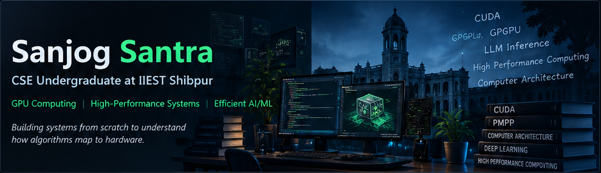
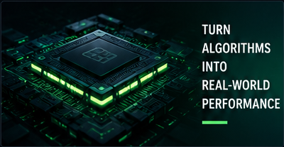

  

---

<table>
<tr>
<td width="60%" valign="middle">

## About Me

I'm a computer science undergraduate at **IIEST Shibpur**, interested in performance-oriented computing, GPU programming, and efficient AI systems.

I enjoy building substantial projects from scratch, understanding their underlying mathematics and algorithms, and investigating how implementation choices affect correctness, memory usage, and performance.

My current direction is **GPU systems and efficient AI infrastructure**, with a focus on CUDA, numerical kernels, computer architecture, and LLM inference.

</td>
<td width="40%" valign="middle">

</td>
</tr>
</table>

---

## ⚙️ Tech Stack

<table>
<tr>
<td width="25%" valign="top">

**Languages**

</td>
<td width="25%" valign="top">

**Web Technologies**

</td>
<td width="25%" valign="top">

**Libraries**

</td>
<td width="25%" valign="top">

**Tools**

</td>
</tr>
</table>

---

## 🚀 Featured Projects

<table>
<tr>
<td width="50%" valign="top">

### [AetherTrace ↗](https://github.com/sanjog1000/AetherTrace)

**GPU Path Tracer**

A GPU-enabled ray tracer exploring CUDA, physically based rendering, Monte Carlo light transport, BVH acceleration, and advanced materials.

</td>
<td width="50%" valign="top">

### [DeepSeekr ↗](https://github.com/sanjog1000/DeepSeekr)

**Search Engine from Scratch**

A search engine exploring crawling, inverted indexes, relevance ranking, query processing, semantic retrieval, and GPU acceleration.

</td>
</tr>
<tr>
<td width="50%" valign="top">

### [gemm-foundry ↗](https://github.com/sanjog1000/gemm-foundry)

**CUDA GEMM Library · In Progress**

A matrix multiplication library with baseline, tiled, and register-blocked kernels. Further kernel optimization and architecture-specific paths are under development.

</td>
<td width="50%" valign="top">

### [HopperKV ↗](https://github.com/sanjog1000/hopper-weave)

**LLM Inference Engine · Early Stage**

An ambitious project exploring memory- and compute-efficient LLM inference, with a long-term focus on KV-cache management and Hopper-specific GPU execution.

</td>
</tr>
<tr>
<td colspan="2" valign="top">

### [LuminaryRenderer ↗](https://github.com/sanjog1000/LuminaryRenderer)

**CPU Ray Tracer**

A Monte Carlo renderer exploring depth of field, procedural noise, advanced lighting, and image post-processing.

</td>
</tr>
</table>

[**View all repositories →**](https://github.com/sanjog1000?tab=repositories)

---

<table>
<tr>
<td width="50%" valign="top">

## 🧠 Research Interests

- GPU programming and GPGPU optimization
- Parallel algorithms and high-performance computing
- Memory systems and hardware-aware optimization
- Efficient deep learning and LLM inference
- Computer architecture and numerical computation

</td>
<td width="50%" valign="top">

## 🎯 Current Focus

- Developing and evaluating CUDA GEMM kernels.
- Building HopperKV incrementally.
- Studying Transformer attention and KV-cache mechanisms.
- Exploring research opportunities in GPGPU optimization and efficient AI systems.

</td>
</tr>
</table>

---

> *Interested in building, measuring, and understanding high-performance computing systems — not just using them.*

**[GitHub](https://github.com/sanjog1000) · [Repositories](https://github.com/sanjog1000?tab=repositories)**

